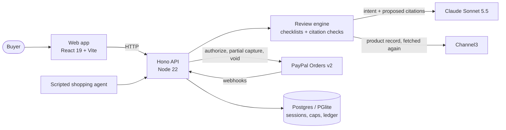

# Fitcheck

**Your agent can pay. Fitcheck checks what it's paying for.**

A shopping agent picks a product for you. Before PayPal captures the money, Fitcheck fetches the
product record again and checks every requirement you have, including the ones nobody asked
about. Each one has to be backed by a line of the store's listing.

- Hosted demo: <!-- HOSTED_URL --> (no account of your own and no key needed; about a minute per purchase)
- Video: <!-- VIDEO_URL -->
- PayPal sandbox buyer for the cap approval: shown on the demo's cap screen <!-- SANDBOX_BUYER -->

## What happens at checkout

Fitcheck sits between a shopping agent and PayPal. The buyer approves one spending cap once. Each
time the agent wants to buy, Fitcheck reviews the purchase and does one of three things:

| The listing...                        | Fitcheck                                                                                     |
|---------------------------------------|----------------------------------------------------------------------------------------------|
| backs every requirement               | PayPal captures the price of that purchase from the cap. The buyer is not asked anything.    |
| is silent, or disagrees with itself   | The payment waits. The buyer gets one card with up to three lines, each answered yes, no or don't know. It pays only if every answer is yes. |
| breaks a requirement                  | Nothing is captured and the buyer is not bothered. The purchase goes back to the agent with the reason. |

## Where PayPal and AI do the work

- **PayPal Orders v2, intent AUTHORIZE.** The buyer approves a $3,000.00 spending cap once on
  PayPal's page. Every purchase Fitcheck approves is a **partial capture** against that
  authorization (`final_capture: false`). Reset **voids** the authorization, so whatever was not
  captured is released. **Webhooks** confirm captures and voids, and every PayPal call carries a
  `PayPal-Request-Id` derived from ids, so a retry never captures twice.
- **Claude Sonnet 5.5** turns the buyer's request into an intent (category, budget, and the
  requirements said and implied) and must quote the buyer's words verbatim. It also proposes which
  listing field backs each requirement. **Code verifies every quote and every value**: the model
  never decides a pass. If the model fails or returns something invalid, Fitcheck fails closed:
  nothing is captured and the purchase goes back to the agent with "Fitcheck could not check this
  listing."
- **Channel3** is the only source of product facts. The record is fetched again at payment time,
  so nothing is taken from the agent's word. The cited field is shown with the quote highlighted,
  and when two fields disagree (a TV whose title says 65 inches and whose features say 55) both are
  shown.

## The judges' path

Open the demo and approve the cap with the sandbox buyer shown on the cap screen. Then run the
four purchases:

1. **A hair dryer for a trip to Spain, under $40.** The agent picks a dryer whose listing says
   "For use with 110V–120V outlets only." Spain uses 230 V. Nothing is captured; the purchase goes
   back to the agent, which picks a dual-voltage dryer. That one is captured.
2. **The cheapest hair dryer for the same trip.** The listing never mentions voltage. The buyer
   gets one question. Answer no, and the agent picks another dryer.
3. **A 65-inch OLED TV, up to $1,500.** The listing's title says 65 inches and its features say
   55 inches. The buyer is asked about the disagreement before $1,398.00 is captured.
4. **Replace the TV on our living room wall.** Nobody asked about the wall mount; Fitcheck checks
   the VESA pattern and asks once.

The PayPal panel shows the cap, what is on hold, what was captured and the PayPal ids. The
"Fitcheck review" switch turns the review off, so you can see what a spending cap alone pays for.

## Does it work?

<!-- RESULTS_TABLE: filled from eval/results/latest.json after the held-out run -->

Reproduce without any key: `pnpm measure --replay`. Misses, case by case: `eval/results/`.

## What Fitcheck does not check

Fitcheck checks what a Channel3 product record can back: the category, the budget, the price at
the moment of payment, stock, condition, quantity, the chosen variant, the store, the brand, and
the category's requirements (TV screen size, resolution, panel type, wall mount and fit; hair dryer
voltage and diffuser). It does not check returns, warranty, shipping, taxes, memberships, how
trustworthy the store is, or anything agreed in conversation that is not in the listing. Labels are
judged against the Channel3 record, not the physical product. Only TVs and hair dryers are built.

## What is real and what is simulated

- **Real:** the PayPal sandbox calls (authorize, partial captures, void, webhooks), the Claude
  Sonnet 5.5 calls and the live Channel3 records.
- **Simulated:** the shopping agent is scripted: four preset requests with fixed product picks, so
  every judge sees the same story. Fitcheck places no real retailer orders. In the sandbox demo the
  PayPal payee is a test merchant account that stands in for the retailer, and the money is play
  money.
- **Fallbacks, always announced on screen:** if Channel3 does not answer, Fitcheck shows the copy
  recorded on 2026-11-10 and says so. If the PayPal sandbox does not answer, the visit switches to
  simulated PayPal and the PayPal panel says so.

## Architecture



- `packages/contracts`: the Zod schemas shared by the API and the web app. Money is integer cents.
- `packages/checklists`: the requirement lists, as data (`common`, `tv`, `hair_dryer`).
- `apps/backend`: the Hono API, the review engine, the Channel3 gateway, the PayPal gateway
  (mock and sandbox), the payment ledger and the scripted agent.
- `apps/web`: the screens.
- `eval/`: the measurement (tuning and held-out cases, record and replay).
- `fixtures/channel3/`: 118 product records recorded from Channel3 on 2026-11-10.

## Development

pnpm workspaces, Node 22, pnpm 10. Every command runs from the repo root with no credentials:
PayPal, the model and Channel3 all have mock or recorded paths.

```bash
pnpm install
pnpm dev          # backend on :3000 and the web app on :5173; open http://localhost:5173
pnpm test         # every test project
pnpm lint         # Biome
pnpm typecheck
pnpm build
pnpm measure --replay
```

To run against the real services, copy `.env.example` to `.env` and set `PAYPAL_MODE=sandbox`,
`LLM_PROVIDER=anthropic` and `CHANNEL3_MODE=live` with their keys.

More: [deploying on Render](docs/deploy.md), [how the measurement works](docs/measurement.md),
and [a guide to the code](CLAUDE.md).

## License

MIT. See [LICENSE](LICENSE).
